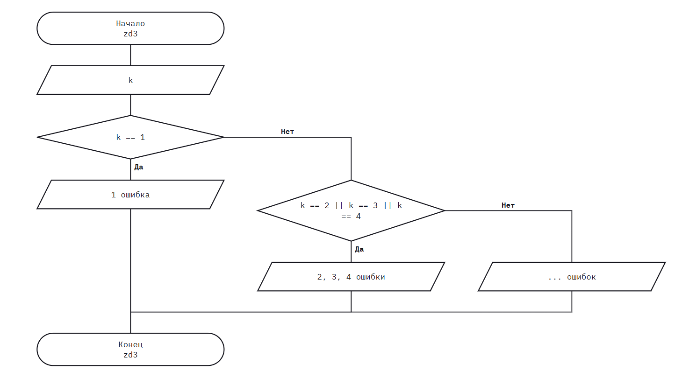

# Домашнее задание к работе 7

## Условие задачи
Для натурального числа k (k<20) напечатать фразу «в программе найдено
k ошибок», согласовав окончание слова «ошибка» с числом k. Использовать
конструкцию if-else недопустимо.

## 1. Алгоритм и блок-схема

### Алгоритм


1. **Ввод данных**

   - Программа считывает целое число и записывает его в переменную k.

2. Ветвление (Оператор switch)

Программа сравнивает значение k со следующими вариантами:
   - Если k == 1: выводится текст с окончанием «ошибка» (например: 1 ошибка).
   - Если k равно 2, 3 или 4: благодаря отсутствию break между кейсами 2, 3 и 4, для всех трёх чисел срабатывает один блок и выводится текст с окончанием «ошибки» (2 ошибки, 3 ошибки, 4 ошибки).
   - При любых других значениях k (все числа, кроме 1, 2, 3, 4): срабатывает блок default и выводится текст с окончанием «ошибок» (5 ошибок, 0 ошибок, 12 ошибок).

3. **Завершение**

   -Функция возвращает 0 и программа завершает работу.

### Блок-схема
 


## 2. Реализация программы

```#define _CRT_SECURE_NO_DEPRECATE
#include <stdio.h>
#include <locale.h>
#include <math.h>

int zd3();

int main() {
    setlocale(LC_CTYPE, ".UTF-8");

    zd3();

    return 0;
}

int zd3() {
    int k;

    scanf("%d", &k);

    switch (k) {
    case 1:
        printf("в программе найдено %d ошибка\n", k);
        break;

    case 2:
    case 3:
    case 4:
        printf("в программе найдено %d ошибки\n", k);
        break;

    default:
        printf("в программе найдено %d ошибок\n", k);
        break;
    }

    return 0;
}
```

## 4. Информация о разработчике

Медведкин Артём Александрович группа бТИИ-262
